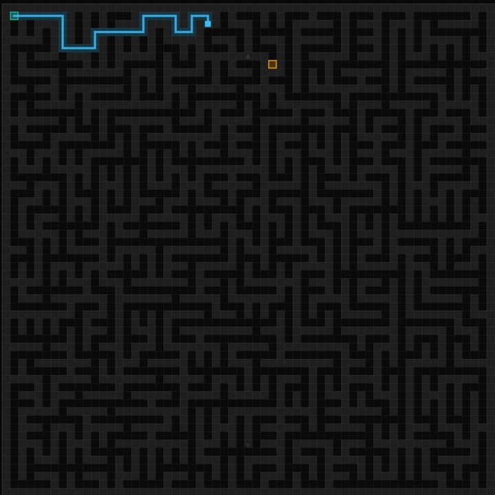

# MINIMALMAZE

A fast, low-latency, 2D top-down maze generation and solving web application. cool maze game basically.


<p align="center">
  
</p>

---

## Features

- **Rust WebAssembly Core (`wasm32-unknown-unknown`)**: Wilson's algorithm (Uniform Spanning Tree) with loop-erased random walks and BFS pathfinder compiled directly to WebAssembly (< 32 KB binary, sub-millisecond generation).
- **Hard Algorithmic Difficulty (1–1000)**: Dense labyrinth structures with zero directional bias and deepest dead-end exit placement, scaling from 5×5 up to 101×101 grids.
- **Intelligent Trail Tracking**: Electric cyan avatar (`#38bdf8`) with automated breadcrumb trail that automatically unwinds and prunes when backtracking out of dead ends.
- **Subconscious Sub-Pixel Hairline Grid**: Subtle 1px grid overlay for instant spatial navigation without visual noise.
- **Dedicated Chronometer**: Centered hero timer with Stopwatch, Countdown challenge, and Hidden zen modes.
- **Hardware-Accelerated Blit Pipeline**: Pre-cached offscreen static canvas drops per-move redraw latency to < 0.05ms.
- **Cross-Platform Low Latency Controls**:
  - **Mobile**: Fullscreen edge-tap quadrants (`▲`, `▼`, `◀`, `▶`), touch swipe gestures, and viewport auto-fit (`100dvh`).
  - **Desktop**: `WASD` & Arrow keys, direct cell click-to-step, quick hotkeys (`R` to regenerate, `F` for fullscreen, `T` for timer mode).
- **High-Resolution PNG Export**: Downloadable crisp maze image exports (1024px or 2048px print resolution) supporting printable black & white mode and dark obsidian mode.
- **KAT Square Minimalist Aesthetics**: Razor-sharp `border-radius: 0 !important;`, obsidian dark palette (`#0b0b0b`), bold JetBrains Mono / Space Mono typography, and monochrome boxed mini-maze branding.
- **Zero Single Point of Failure**: Dual-layered engine with native Wasm streaming, embedded base64 fallback (offline `file://` compatibility), and pure JavaScript generator fallback.

---

## Directory Structure

```
minimalmaze/
├── engine/              # Rust core crate
│   ├── Cargo.toml       # Cargo manifest (cdylib + rlib)
│   └── src/
│       └── lib.rs       # Maze generation, BFS solver, PRNG, FFI exports & unit tests
├── tests/               # Test suites
│   └── game_logic.test.js # Node.js test runner suite
├── core_logic.js        # Universal core logic & Wasm wrapper
├── app.js               # Canvas 2D renderer, input handling, HUD loop
├── style.css            # KAT Square Minimalist styles
├── index.html           # Main application entry point
├── engine.wasm          # Precompiled release WebAssembly binary (31KB)
├── wasm_embedded.js     # Embedded fallback base64 binary
└── build.sh             # Build script for Rust Wasm compilation
```

---

## Quick Start

### Running Locally
You can serve the static files with any local HTTP server:

```bash
# Using Node.js
npx serve minimalmaze

# Or Python
python3 -m http.server 8080 --directory minimalmaze
```

Open `http://localhost:8080` in any modern web browser.

### Building the Rust Engine
Requires Rust toolchain with `wasm32-unknown-unknown` target:

```bash
rustup target add wasm32-unknown-unknown
./build.sh
```

---

## Controls

| Action | Mobile | Desktop |
|---|---|---|
| Move Up | Tap top screen quadrant / Swipe up | `W` or `↑` |
| Move Down | Tap bottom screen quadrant / Swipe down | `S` or `↓` |
| Move Left | Tap left screen quadrant / Swipe left | `A` or `←` |
| Move Right | Tap right screen quadrant / Swipe right | `D` or `→` |
| Regenerate | `[ REGENERATE ]` button | `R` key |
| Toggle Fullscreen | `[ FULLSCREEN ]` button | `F` key |
| Show / Hide Solution | `[ SHOW SOLUTION ]` | Click button |
| Export PNG | `[ DOWNLOAD PNG ]` | Click button |

---

## Verification & Tests

```bash
# Run Rust unit tests (solvability, scale, performance)
cd engine && cargo test

# Run JavaScript integration tests (movement, collision, wasm loading, formulas)
node --test tests/game_logic.test.js
```
